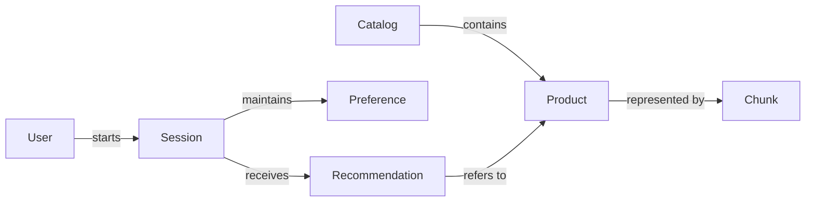

# Requirements Specification

Phase 1. This document describes the intended complete system, with detailed Phase 1 requirements. Later-phase requirements do not imply completed implementation.

## 1. Overview

A conversational shopping recommender helps users find games and gaming accessories in Amazon Reviews 2023 / `Video_Games`. It combines a searchable product catalog with an LLM endpoint.

## 2. Business case

Users with unclear preferences receive suitable product suggestions through clarifying questions and explanations grounded in actual catalog data, reducing the effort of searching a large catalog.

## 3. Glossary

| Term | Description |
|---|---|
| Catalog | The cleaned collection of products available for recommendations. |
| Chunk | A text section representing part of a product's information. |
| Embedding | A numerical text representation used for semantic similarity search. |
| Guardrail | A check that keeps inputs and outputs safe, relevant, and catalog-backed. |
| Product | A catalog item identified by its original Amazon `parent_asin`. |
| RAG | Retrieval-Augmented Generation: retrieve catalog evidence and use it to generate an answer. |
| Session | One conversation whose history and preferences share a `thread_id`. |

## 4. System functions

IDs 1.x belong to Phase 1 / Flo; 2.x to Phase 2; 3.x to Phase 3; and 4.x to Phase 4. Types follow the lecture: `evident` is visible to the user; `hidden` runs in the background. Required functions have `high` priority.

| ID | requirement | type | priority |
|---|---|---|---|
| 1.1 | Load JSONL or gzip-compressed JSONL item metadata and build a catalog of at least 100,000 distinct accepted `Video_Games` products. | hidden | high |
| 1.2 | Remove HTML and normalize whitespace; reject missing IDs or empty titles, deduplicate IDs, and retain useful products with missing optional fields. | hidden | high |
| 1.3 | Preserve original product IDs and provide the fixed product metadata defined in Section 6. | hidden | high |
| 1.4 | Split product text into chunks, generate embeddings, and persist a searchable vector index with references to the complete product records. | hidden | high |
| 1.5 | Search products by semantic similarity and return at most the requested number of distinct products. | evident | high |
| 1.6 | Apply minimum/maximum price, minimum rating, and category filters to search results. | evident | high |
| 1.7 | Retrieve a complete product record by its original ID using `get_by_id`. | hidden | high |
| 1.8 | Return an empty result list when no products match and `None` for an unknown product ID, without inventing replacements. | hidden | high |
| 2.1 | Ask clarifying questions or offer helpful options when preferences are unclear, and let users refine their requests. | evident | high |
| 2.2 | Maintain conversation history, preferences, and feedback throughout the active session. | hidden | high |
| 2.3 | Use retrieved catalog evidence when generating recommendations. | hidden | high |
| 3.1 | Check inputs for off-topic, inappropriate, or prompt-injection requests before the recommendation workflow. | hidden | high |
| 3.2 | Check generated outputs for valid catalog products, supported claims, correct formatting, and safety. | hidden | high |
| 4.1 | Provide a usable interface showing available product details (title, description, price, rating, features) and a preference-based explanation for each recommendation, with a way to give feedback or refine the request. | evident | high |

## 5. System attributes

| attribute | constraint | priority |
|---|---|---|
| catalog integrity | Every recommended product ID must exist in the catalog; displayed attributes must agree with the available product data. | high |
| filter correctness | Every returned product must satisfy all supplied filters. Unknown prices or ratings must not satisfy the corresponding numeric filters; categories match an existing label case-insensitively. | high |
| data fidelity | Missing numeric values, brand, and image URL remain unknown; missing descriptions and lists remain empty. A missing price must not become zero. | high |
| persistence | A completed catalog and vector index must be reusable in a new process with compatible embeddings, without rebuilding. | high |
| session isolation | Different `thread_id` values must keep conversation histories and preferences separate. | high |

## 6. Conceptual models

The fixed product record contains `item_id`, `title`, `description`, `features`, `categories`, `price`, `currency`, `average_rating`, `rating_number`, `brand`, `image_url`, `review_snippets`, and `source`. `item_id` is the original `parent_asin`; each chunk retains that identity. Required fields are ID and title; other fields follow the missing-value policy above. Reviews are optional (and must be downloaded seperately...), so `review_snippets` is initially empty.

The typed metadata contract and retriever usage are documented in the [Phase 1 handoff](../README.md#phase-1-handoff-foundation-and-data-grounding).

## 7. Constraints & interfaces

| Type | Example |
|---|---|
| External interface | Amazon Reviews 2023 / `Video_Games` item metadata supplies the catalog; separate customer reviews are optional. |
| Shared interface | `CatalogRetriever.search(query, filters=None, k=None)` returns LangChain `Document` objects; `get_by_id(item_id)` returns one `Document` or `None`. Search results expose canonical metadata and the matching text chunk. |
| External interface | LLMDuckt or another LLM endpoint (e.g. OpenAI-API) provides generation for the later agent workflow. |
| Technical constraint | Use LangChain and LangGraph, with `MemorySaver` and distinct `thread_id` values for session state. |
| Phase 1 constraint | Use Chroma and local `all-MiniLM-L6-v2` via `HuggingFaceEmbeddings`: normalized 384-dimensional vectors, with the same pinned model revision and compatible settings for indexing and queries. |
| Phase 1 constraint | Use token-aware chunks of at most 220 tokens with 24-token overlap. A sample build does not replace the required full catalog. |
| Usage constraint | LLMDuckt allows 1,000 prompts per student per month (Local indexing and retrieval require no LLM API calls). |
